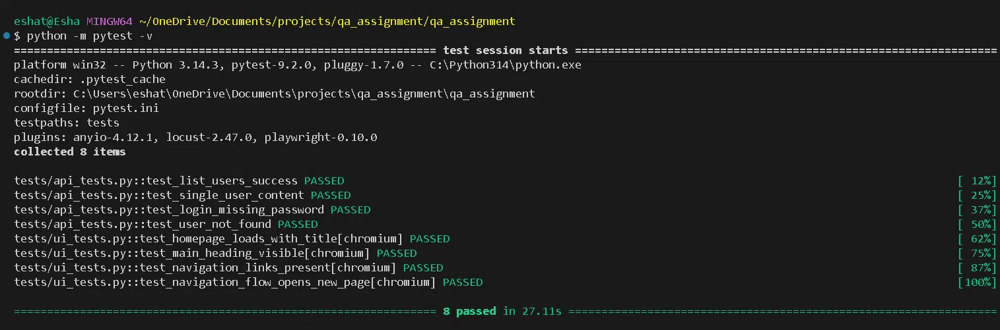
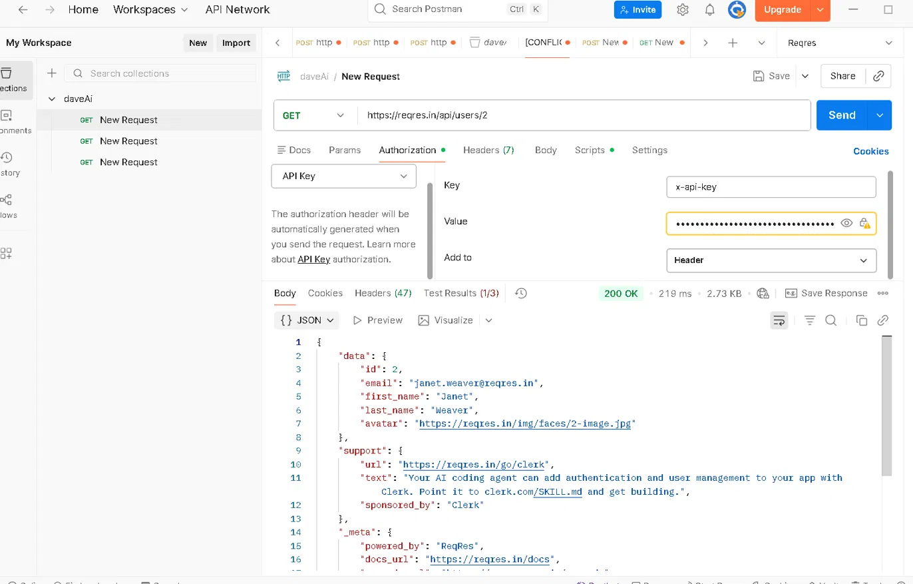

# QA Automation Assignment

Automated tests written in Python:

- **API tests** for the Reqres API (pytest + requests)
- **UI tests** for [https://www.iamdave.ai](https://www.iamdave.ai) (Playwright + pytest)
- **Load testing** (bonus) with Locust

## Project Structure

```text
qa_assignment/
├── tests/
│   ├── api_tests.py
│   └── ui_tests.py
├── postman/
│   └── Postman collection
├── screenshots/
│   ├── all_test_case.png
│   └── api.png
├── results/
│   ├── run1_stats.csv
│   ├── run1_stats_history.csv
│   ├── run1_failures.csv
│   ├── run1_exceptions.csv
│   ├── run2_stats.csv
│   ├── run2_stats_history.csv
│   ├── run2_failures.csv
│   └── run2_exceptions.csv
├── load_test.py
├── locust.ipynb
├── pytest.ini
├── requirements.txt
└── README.md
```

## How to Set Up

1. Install Python 3.10+ and open a terminal in the project folder.

2. (Optional) Create a virtual environment:

   ```bash
   python -m venv venv
   ```

   Activate it:

   ```bash
   # Windows PowerShell
   venv\Scripts\activate

   # Git Bash / Linux / macOS
   source venv/bin/activate
   ```

3. Install the required packages and Chromium browser:

   ```bash
   python -m pip install -r requirements.txt
   python -m playwright install chromium
   ```

4. Get a free API key from [Reqres](https://reqres.in) and set it as an environment variable. The API tests require this key.

   ```bash
   # Windows PowerShell
   $env:REQRES_API_KEY="your_key_here"

   # Git Bash
   export REQRES_API_KEY=your_key_here
   ```

   The API key is read from an environment variable and is not stored in the source code.

## How to Run the Tests

Run all eight tests:

```bash
python -m pytest -v
```

Run API tests only:

```bash
python -m pytest tests/api_tests.py -v
```

Run UI tests only:

```bash
python -m pytest tests/ui_tests.py -v
```

Run UI tests with a visible browser:

```bash
python -m pytest tests/ui_tests.py -v --headed
```

**Setup and teardown:** Pytest fixtures automatically handle the HTTP session and browser lifecycle. Each UI test gets a fresh browser context to help prevent tests from affecting one another.

## What the Tests Check

### API Tests (Reqres)

| Test | What it checks |
|---|---|
| `test_list_users_success` | `GET /users?page=2` returns 200, page is 2, and the user list contains the expected fields |
| `test_single_user_content` | `GET /users/2` returns the expected user ID and a valid email |
| `test_login_missing_password` | `POST /login` without a password returns 400 and an error message |
| `test_user_not_found` | `GET /users/23` returns 404 for an invalid user ID |

### UI Tests (iamdave.ai)

| Test | What it checks |
|---|---|
| `test_homepage_loads_with_title` | The website loads without an error and the title contains "dave" |
| `test_main_heading_visible` | The homepage displays a visible, non-empty main heading (`h1`) |
| `test_navigation_links_present` | The navigation contains several links and the page has images |
| `test_navigation_flow_opens_new_page` | Clicking a menu link opens a different page or a new tab |

## Screenshots

### Test Cases



### Postman API Testing



## Load Testing with Locust

Load testing was implemented using Locust and executed in **Google Colab** because Windows Application Control blocked a gevent dependency in the local environment.

The load test targets the Reqres API endpoint:

```text
https://reqres.in/api
```

### Execution in Google Colab

Open the provided `locust.ipynb` notebook and execute the following commands:

```python
!pip install locust
!mkdir -p results

!python -m locust -f load_test.py \
  --host https://reqres.in/api \
  --headless -u 5 -r 1 -t 30s \
  --csv results/run2
```

The command runs a headless test with five concurrent users, a spawn rate of one user per second, and a duration of 30 seconds.

### Dependencies Used

- Locust 2.47.0
- gevent 26.9.0
- greenlet 3.5.6

The API and UI automation tests were executed locally on Windows using pytest and Playwright. Locust was executed separately in Google Colab.

### Test Plan and Results

Two load-test runs were performed with different concurrent user counts.

| Metric | Run 1 | Run 2 |
|---|---:|---:|
| Concurrent Users | 2 | 5 |
| Duration | 30 seconds | 30 seconds |
| Total Requests | 15 | 34 |
| Successful Requests | 15 | 5 |
| Failed Requests | 0 | 29 |
| Failure Rate | 0% | 85.29% |
| Average Response Time | 184.86 ms | 179.13 ms |
| Median Response Time | 170 ms | 170 ms |
| 95th Percentile | 370 ms | 240 ms |
| Requests per Second | 0.54 | 1.23 |

### Findings

- **Run 1:** All 15 requests completed successfully, with no failures.
- **Run 2:** 29 out of 34 requests failed.
- All 29 failures returned **HTTP 429 (Too Many Requests)**, indicating that the API's rate-limiting mechanism restricted requests during the test.
- The average response time was approximately 185 ms in Run 1 and 179 ms in Run 2.
- Response-time statistics include both successful and failed requests. Therefore, they should not be interpreted as successful-request latency alone.
- These results represent two short test runs and do not establish the API's maximum capacity.

### Load Testing Reports

The `results/` directory contains the CSV reports generated by Locust:

- `run1_stats.csv` and `run2_stats.csv` – Request counts, failures, and response-time statistics.
- `run1_stats_history.csv` and `run2_stats_history.csv` – Performance statistics recorded throughout the tests.
- `run1_failures.csv` and `run2_failures.csv` – Failed request details.
- `run1_exceptions.csv` and `run2_exceptions.csv` – Exception reports.

## Postman (Extra)

The `postman/` directory contains a Postman collection with the same four API test scenarios.

Import the collection into Postman, configure your own `x-api-key` header, and use **Run Collection** to execute the requests.

## Why I Made These Choices

- **pytest:** Requires less boilerplate than unittest, provides fixtures for setup and teardown, and supports simple assertions.
- **API tests:** Cover successful responses, response-content validation, and error-handling scenarios. Requests use timeouts to prevent tests from hanging.
- **Playwright:** Provides automatic waiting for elements, reducing the need for fixed sleeps and helping make UI tests more reliable.
- **UI locators:** Use generic locators such as `h1` and `nav a` instead of fragile CSS class names. The navigation test tries multiple links rather than depending on a single link.
- **Locust:** Provides a simple Python-based way to simulate concurrent users and measure API performance. Responses are checked for content as well as status codes.